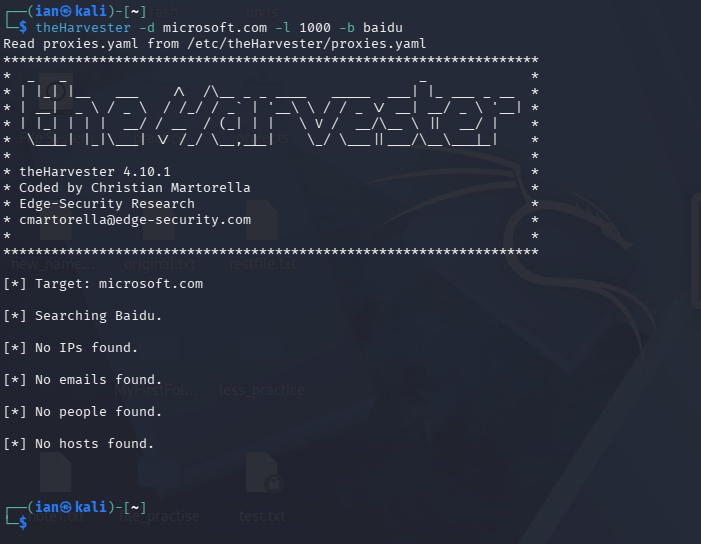
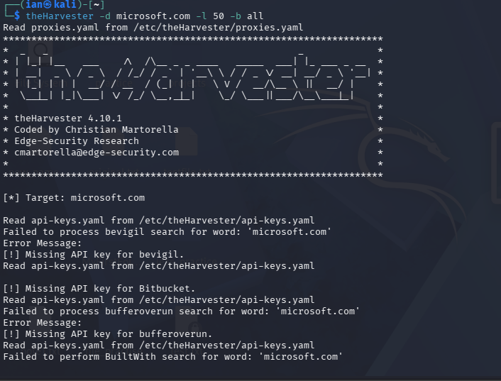

# Week 2: Footprinting & Network Scanning Report

1. Liability Disclaimer
I have performed these activities only on the systems & devices where I had secured written permission or the devices/systems that I own myself. All these materials are for education and research purpose only. Do not use anything from here to break the law.

 2. Introduction
This report covers footprinting the microsoft.com domain using theHarvester (W2-PM4) and scanning my own local network with Zenmap (W2-PM5). 

 3. Tools Used
- **theHarvester:** OSINT tool used to gather emails and subdomains from public sources.
- **Zenmap:** The official GUI for Nmap, used to scan the local network for live hosts.

 4. Activities Performed

 4.1 Footprinting with theHarvester
I used theHarvester to gather information about microsoft.com. 
- **Task 1:** I ran a search using Baidu with a limit of 1000 results. The output was saved as `harvester_baidu.txt`.
- **Task 2:** I ran a search using all sources with a limit of 50 results. The output was saved as `harvester_all.txt`.

 4.2 Network Scanning with Zenmap
I used Zenmap to scan my local network (192.168.137.0/24). 
- **Results:** The scan identified 2 live hosts.
- **IP Addresses:** 192.168.137.1 and 192.168.137.107.
- **MAC Address:** The MAC address for the router (192.168.137.1) was identified as CE:5E:F8:08:EA:55. The MAC address for my own PC was not displayed by the scan, which is expected behavior.
- **Topology:** The network topology was saved as a PDF (`zenmap_topology.pdf`).

5. Risk Analysis / Impact
- **Public Information Exposure:** theHarvester revealed email addresses and subdomains for microsoft.com. While this is a massive organization, for smaller companies, this information can be used for phishing campaigns or mapping the attack surface. (Risk: Medium)
- **Live Hosts on Network:** Zenmap identified 2 live hosts on my local network. Unknown devices on a network can pose a security risk if not monitored. (Risk: Medium)

 6. Recommendations
- Organizations should regularly review what public information (emails, subdomains) is exposed.
- Regular network scans should be performed to identify any unauthorized devices.
- Employees should be trained to recognize phishing attempts, as email harvesting is a common precursor.

 7. Conclusion
During Week 2, I learned how to perform passive reconnaissance using theHarvester and active network scanning using Zenmap. TheHarvester showed me how much information is publicly available, while Zenmap helped me understand how to map a network and identify live devices. All activities were performed within the authorized scope of my own lab and Networkwalks' internship guidelines.

 8. Evidence
### theHarvester - Baidu Search

### theHarvester - All Sources Search

### Zenmap Network Scan

###My-PenTest-Result

